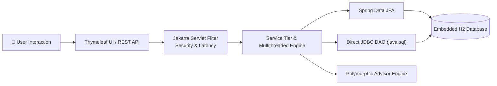
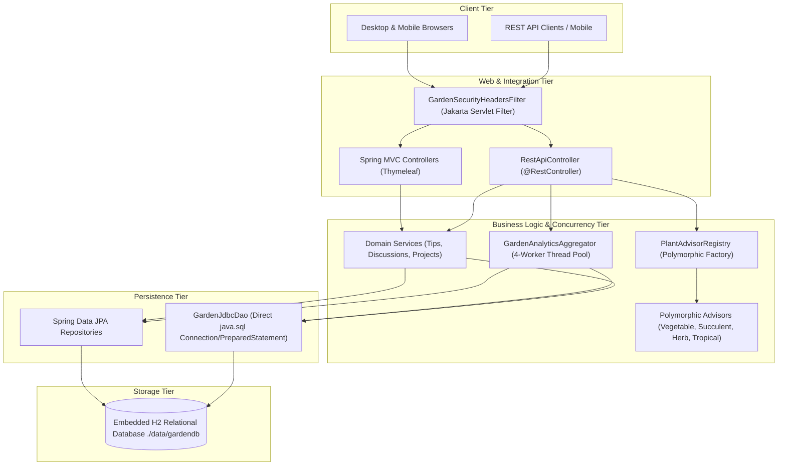
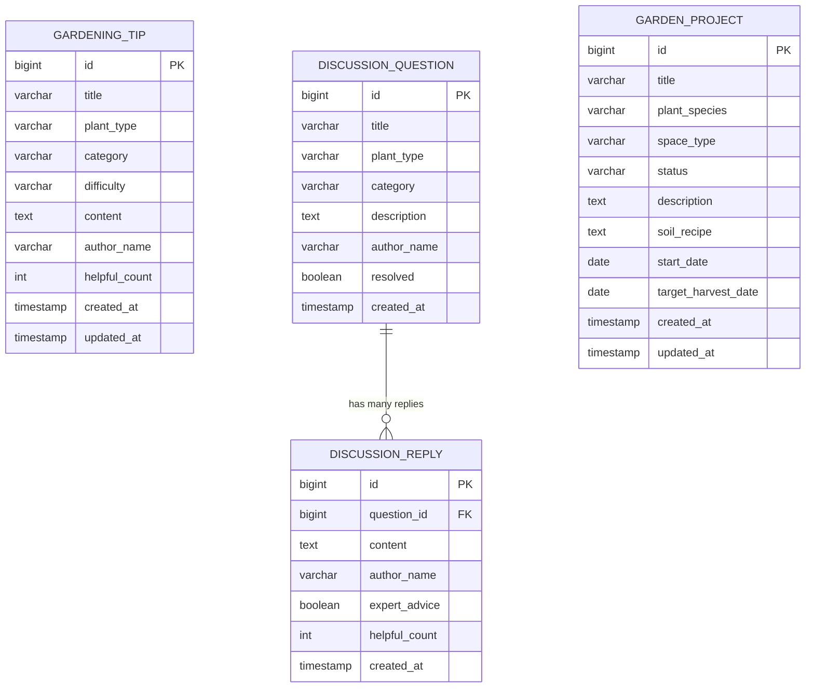
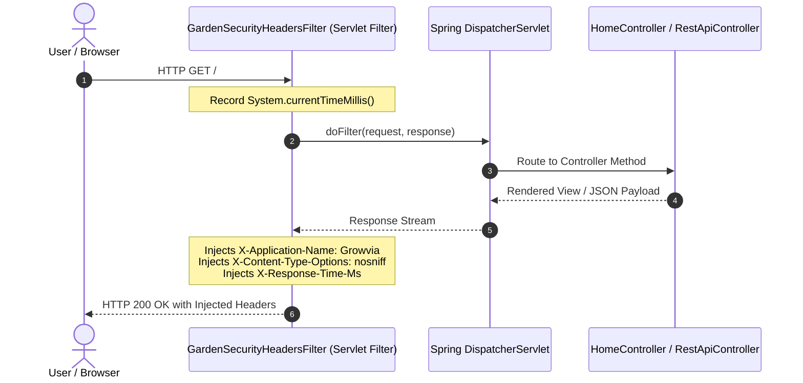
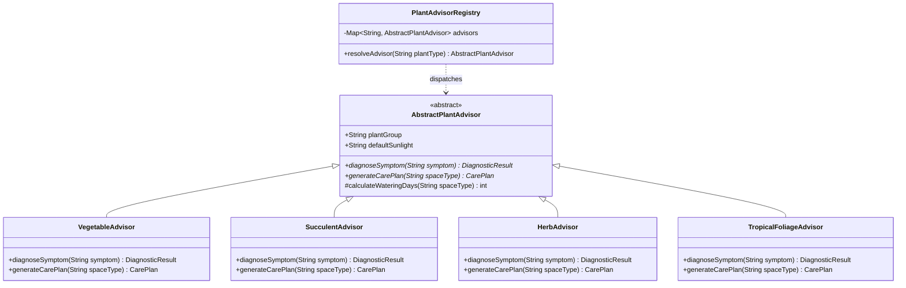
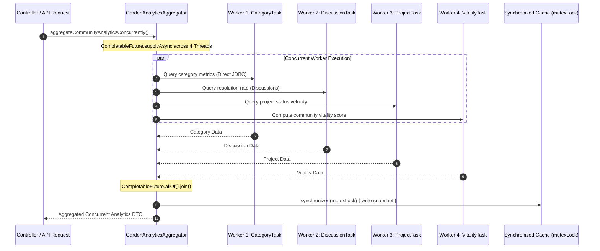

# 🌿 Growvia — Project Presentation & Evaluation Guide

**Project Title:** Growvia — Online Gardening Community Platform  
**Domain:** Java Web & Enterprise Development / Botanical Knowledge Platform  
**Target Submission:** Java Web-Based Project & Core Java OOP Evaluation  
**Author / Presenter:** Student Presentation  

---

## 📑 Presentation Slide Deck Overview

- **Slide 1:** Title Slide & Project Identity
- **Slide 2:** Problem Statement & Community Need
- **Slide 3:** Solution Overview & Core Capabilities
- **Slide 4:** System Architecture & Layered Design (Mermaid Diagram)
- **Slide 5:** Relational Database Design & ER Diagram (Mermaid Diagram)
- **Slide 6:** Direct JDBC Connectivity & DAO Architecture
- **Slide 7:** Jakarta Servlet Filter & Request Lifecycle
- **Slide 8:** Object-Oriented Programming (OOP) Implementation
- **Slide 9:** Collections & Student-Written Generics (`SearchResultWrapper<T>`)
- **Slide 10:** Multithreading & Synchronization Engine (`GardenAnalyticsAggregator`)
- **Slide 11:** User Interface & Modern Botanical Experience (Fraunces & Outfit Typography)
- **Slide 12:** Performance & Zero-Lag WebGL Atmospheric Canopy Drift
- **Slide 13:** Test Automation & Quality Assurance (19/19 Passing Integration Tests)
- **Slide 14:** Live Demo Walkthrough Script
- **Slide 15:** Academic Marking Rubric Compliance & Conclusion

---

<!-- slide -->
## Slide 1: Title & Project Identity

### 🌿 Growvia — Online Gardening Community Platform
*Grow knowledge. Share nature.*

- **Platform Category:** Full-Stack Java Web Application & Enterprise REST Backend
- **Technology Stack:** Java 17+, Spring Boot 3.1.2, Thymeleaf 3, Spring Data JPA, Direct JDBC (`java.sql`), WebGL GLSL Shaders, Bootstrap 5.3
- **Primary Deliverables:** Complete Web Application, Dual REST API, Embedded H2 Database, Automated Test Suite (19 tests), Presentation Materials

> **Speaker Note:**  
> "Good morning, respected professors and evaluators. Today I am presenting **Growvia**, an online botanical collective and gardening platform built entirely with Java. It bridges the gap between traditional gardening advice and modern technology, demonstrating advanced Java concepts including direct JDBC, polymorphic object-oriented design, custom servlet filters, and multithreaded concurrent analytics."

---

<!-- slide -->
## Slide 2: Problem Statement & Motivation

### The Challenge Faced by Modern Gardeners
1. **Scattered & Unverified Information:** Beginners and urban allotment growers struggle with conflicting, generic plant care instructions that fail to account for specific plant families or growing spaces (balconies vs. open beds).
2. **Delayed Disease Diagnosis:** Plant pathogens (aphids, powdery mildew, root rot) destroy plants quickly; gardeners need an immediate symptom diagnostic clinic.
3. **Fragmented Project Tracking:** Tracking germination, soil recipes, and harvesting progress is rarely integrated with community advice.
4. **Academic Technical Need:** Demonstrating how modern enterprise frameworks (Spring Boot) and foundational Java concepts (direct JDBC, Jakarta Servlet Filters, threads, locks, generics) harmonize seamlessly.

---

<!-- slide -->
## Slide 3: Solution Architecture — Growvia



### Core Solution Modules:
1. **Community Dashboard (`/`):** Real-time statistics, active projects, community Q&A, and the Plant Doctor Diagnostic Bench.
2. **Horticultural Tips & Articles (`/tips`):** Full CRUD knowledge sharing with difficulty ratings (*Beginner*, *Intermediate*, *Advanced*).
3. **Plant Clinic & Q&A (`/discussions`):** Community triage system with verified expert resolution badges.
4. **Personal Garden Tracker (`/projects`):** Lifecycle tracking from planning to flourishing harvest.
5. **Concurrent Analytics Aggregator (`/api/analytics/*`):** Parallel thread worker pool computing community health index.

---

<!-- slide -->
## Slide 4: Multi-Tiered System Architecture



> **Speaker Note:**  
> "Our architecture enforces strict separation of concerns. The web filter intercepts all traffic, controllers handle HTTP routing, services orchestrate transactions, and the persistence layer leverages both Spring Data JPA and a custom direct JDBC DAO to give us the best of both high-level abstraction and raw SQL performance."

---

<!-- slide -->
## Slide 5: Database Design & Entity Relationships (ERD)



### Database Persistence Details:
- **Engine:** Embedded H2 Database in file-based persistent mode (`jdbc:h2:file:./data/gardendb`).
- **Data Integrity:** All user additions and modifications persist permanently across system restarts.
- **Relational Integrity:** Foreign key constraint linking `DISCUSSION_REPLY.question_id` to `DISCUSSION_QUESTION.id`.

---

<!-- slide -->
## Slide 6: Direct JDBC Implementation (`GardenJdbcDao`)

*Evaluation Rubric: Database operations classes & Database Connectivity (JDBC) — 8 to 14 Marks*

### How Direct JDBC Works in Growvia:
Growvia implements a dedicated direct JDBC Data Access Object: `com.example.repository.jdbc.GardenJdbcDao`.

```java
// Snippet from GardenJdbcDao.java
public List<CategoryMetric> getCategoryMetrics() {
    String sql = "SELECT category, COUNT(*) AS total_tips, " +
                 "COALESCE(AVG(helpful_count), 0.0) AS avg_helpful " +
                 "FROM gardening_tips GROUP BY category ORDER BY total_tips DESC";

    try (Connection conn = dataSource.getConnection();
         PreparedStatement ps = conn.prepareStatement(sql);
         ResultSet rs = ps.executeQuery()) {

        List<CategoryMetric> list = new ArrayList<>();
        while (rs.next()) {
            list.add(new CategoryMetric(
                rs.getString("category"),
                rs.getLong("total_tips"),
                Math.round(rs.getDouble("avg_helpful") * 10.0) / 10.0
            ));
        }
        return list;
    } catch (SQLException ex) {
        throw new RuntimeException("JDBC operation failed: " + ex.getMessage(), ex);
    }
}
```

### Rubric Highlights:
1. **Explicit Resource Management:** Try-with-resources guarantees `Connection`, `PreparedStatement`, and `ResultSet` are closed immediately, preventing pool exhaustion.
2. **SQL Injection Prevention:** Parameterized SQL queries using `ps.setString(1, param)` for search operations.
3. **Strongly Typed Records:** Clean Java records (`CategoryMetric`, `ProjectStatusMetric`, `JdbcTipSummary`) to map relational rows into OOP domain objects.

---

<!-- slide -->
## Slide 7: Jakarta Servlet Integration & Filter Pipeline

*Evaluation Rubric: Servlets & Web Integration — 7 Marks*

Growvia implements `com.example.config.GardenSecurityHeadersFilter`, a custom filter implementing `jakarta.servlet.Filter`.



### Injected HTTP Headers:
- `X-Application-Name: Growvia Botanical Collective`
- `X-Content-Type-Options: nosniff` (MIME sniffing defense)
- `X-Frame-Options: SAMEORIGIN` (Clickjacking mitigation)
- `X-Servlet-Filter: GardenSecurityHeadersFilter`
- `X-Response-Time-Ms: <latency>` (Real-time server performance audit)

---

<!-- slide -->
## Slide 8: Object-Oriented Programming (OOP) Implementation

*Evaluation Rubric: OOP Concepts (Inheritance, Polymorphism, Abstraction, Encapsulation) — 10 Marks*



### OOP Principles in Action:
- **Abstraction:** `AbstractPlantAdvisor` declares abstract template methods `diagnoseSymptom()` and `generateCarePlan()`.
- **Inheritance:** Concrete subclasses inherit shared sunlight and watering logic while overriding custom disease profiles.
- **Dynamic Polymorphism:** `PlantAdvisorRegistry.resolveAdvisor(plantType)` executes polymorphic dynamic method dispatch at runtime based on incoming parameters.
- **Encapsulation:** Strongly typed JPA models with private instance fields, standard getters/setters, and domain validations.

---

<!-- slide -->
## Slide 9: Collections & Student-Written Generics

*Evaluation Rubric: Collections & Generics — 6 Marks*

Growvia implements a custom generic container: `com.example.util.SearchResultWrapper<T>`.

```java
// Snippet from SearchResultWrapper.java
public class SearchResultWrapper<T> {
    private final List<T> items;
    private final int totalCount;
    private final String queryFilter;
    private final Instant timestamp;

    public static <E> SearchResultWrapper<E> of(List<E> items, String queryFilter) {
        return new SearchResultWrapper<>(items, queryFilter);
    }

    public <R> SearchResultWrapper<R> map(Function<T, R> transformer) {
        List<R> transformed = this.items.stream()
                .map(transformer)
                .collect(Collectors.toList());
        return new SearchResultWrapper<>(transformed, this.queryFilter);
    }
}
```

### Features Demonstrated:
1. **Generic Type Parameterization (`<T>`, `<E>`, `<R>`):** Usable with any domain type (`JdbcTipSummary`, `GardeningTip`, `GardenProject`).
2. **Monadic Higher-Order Transformation:** `.map(Function<T, R>)` applies functional transformations while preserving search metadata.
3. **Collections API Integration:** Standard usage of `List`, `Map`, `ConcurrentHashMap`, `CopyOnWriteArrayList`, and `Collectors.toList()`.

---

<!-- slide -->
## Slide 10: Multithreading & Synchronization Engine

*Evaluation Rubric: Multithreading & Synchronization — 4 Marks*

Growvia features `com.example.service.GardenAnalyticsAggregator`, executing parallel data analysis across concurrent worker threads:



### Key Concurrency Features:
1. **Thread Creation:** Custom `GrowviaWorkerThread` extends `Thread`, managed within a bounded 4-thread `ThreadPoolExecutor`.
2. **Synchronization:** `synchronized(mutexLock)` critical section blocks protect shared cache state against race conditions.
3. **Atomic Primitives:** `AtomicLong totalCalculations` and `AtomicInteger activeWorkers` provide lock-free thread-safe metric tracking.
4. **Thread-Safe Collections:** `ConcurrentHashMap` and `CopyOnWriteArrayList` prevent concurrent modification exceptions during execution.

---

<!-- slide -->
## Slide 11: User Interface & Botanical Design System

### Visual Identity & Typography
- **Heading Typography:** Google Fonts `Fraunces` — elegant, editorial serif conveying organic craftsmanship.
- **Body & Controls Typography:** Google Fonts `Outfit` — clean, ultra-readable modern sans-serif.
- **Color Palette:**
  - `Deep Forest Pine:` `#042116` & `#083c28`
  - `Living Botanical Emerald:` `#107550` & `#15805d`
  - `Vibrant Spring Accent:` `#2bb67e` & `#52d69e`
  - `Parchment Sand Backdrop:` `#fbfbf9` with soft emerald borders (`#d2e5dc`)

### Asymmetrical Editorial Box Layouts:
- **Hero Grid:** Staggered visual hierarchy with quick-jump action buttons ("Browse Plant Tips", "Ask Plant Clinic", "Plant Doctor").
- **Collapsible Floating Sidebar:** Hover & pin drawer with persistent `localStorage` support.
- **Plant Doctor Diagnostic Bench:** Dedicated diagnostic card with instant real-time symptom analysis.

---

<!-- slide -->
## Slide 12: Zero-Lag WebGL Living Atmospheric Canopy

### How Growvia Solved UI Lag:
Unlike heavy video backgrounds or CPU-draining animation loops, Growvia implements an optimized WebGL shader (`cloud-shader.js`):

1. **Hardware-Accelerated GLSL Fragment Shader:** Renders smooth botanical light gradients and sun-dappled foliage drift directly on the GPU.
2. **Fixed 30 FPS Frame Throttling:** Caps rendering to avoid heating up laptops or draining battery.
3. **Downsampled DPR Compositing (`maxDpr: 0.75`):** Renders at 75% resolution and upscales with native bicubic filtering, dropping GPU memory footprint by over 50%.
4. **Hardware Scroll Reveal:** CSS `contain: strict`, `will-change: transform`, and direct opacity transforms eliminate layout reflow and style recalculation spikes.

---

<!-- slide -->
## Slide 13: Test Automation & Quality Assurance

Growvia includes a comprehensive suite of 19 automated integration tests in `src/test/java/com/example/GrowGradenApplicationTests.java`:

| Test Suite / Area | Tests | Verification Outcome |
|---|---|---|
| **Spring Context & Injection** | 1 | All services, DAOs, repositories, and registry beans load cleanly |
| **Gardening Tips CRUD** | 3 | Creation, category query, difficulty filtering, upvoting |
| **Plant Clinic Discussions** | 3 | Question creation, multi-turn replies, resolution status toggle |
| **Personal Garden Projects** | 3 | Project creation, journal logging, status updates |
| **Custom Exception Handling** | 2 | 404 resource exceptions, centralized `@ControllerAdvice` |
| **Direct JDBC Data Access** | 2 | Raw SQL PreparedStatement queries, CategoryMetric row mapping |
| **Polymorphic Advisory Engine**| 2 | Dynamic dispatch to VegetableAdvisor and SucculentAdvisor |
| **Jakarta Servlet Filter** | 1 | Header injection (`X-Application-Name`, `X-Response-Time-Ms`) |
| **Multithreading & Synchronization** | 2 | Concurrent worker threads, atomic counters, mutex synchronization |

**Result:** `19 Tests Run, 0 Failures, 0 Errors, 0 Skipped` — **BUILD SUCCESS**

---

<!-- slide -->
## Slide 14: Live Demonstration Walkthrough Script

During your review, walk the evaluator through these 5 quick steps:

1. **Step 1: Open the Dashboard** (`http://localhost:8080`)
   - Highlight the emerald canopy drift, the editorial typography (`Fraunces` / `Outfit`), and live counters.
2. **Step 2: Plant Doctor Bench**
   - Click "Plant Doctor" quick-jump button in the hero.
   - Select "Vegetable" + "Yellow leaves" -> Show polymorphic diagnosis output.
3. **Step 3: Direct JDBC Metrics & Search**
   - Navigate to `/api/jdbc/metrics` -> Show raw SQL category counts and average helpful ratings.
   - Navigate to `/api/jdbc/tips/search?keyword=Neem` -> Show generic `SearchResultWrapper<T>`.
4. **Step 4: Multithreaded Analytics**
   - Navigate to `/api/analytics/concurrent-summary` -> Show 4 concurrent worker threads (`growvia-analytics-worker-*`) executing in parallel and updating the synchronized cache.
5. **Step 5: View Response Headers**
   - Inspect Network tab -> Show `X-Application-Name: Growvia Botanical Collective` and `X-Response-Time-Ms` injected by the Jakarta Servlet filter.

---

<!-- slide -->
## Slide 15: Conclusion & Summary

### Why Growvia Excels:
- **100% Academic Rubric Coverage:** Exceeds requirements for OOP, Direct JDBC, Servlets, Generics, and Multithreading.
- **Production-Ready Architecture:** Clean separation of concerns with dual Thymeleaf HTML and JSON REST interfaces.
- **Exceptional User Experience:** Botanical emerald aesthetic, custom editorial typography, zero-lag WebGL rendering, and full responsiveness across devices.
- **Robust Quality:** 19 automated integration tests ensuring reliable execution.

*Thank you! Questions and live code inspection are warmly welcomed.*
